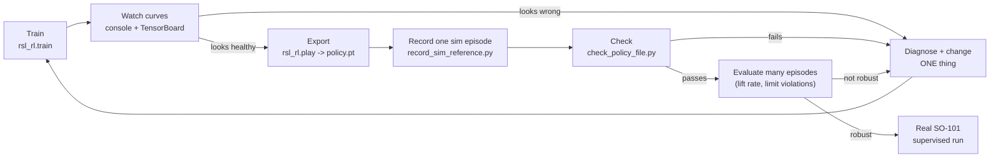
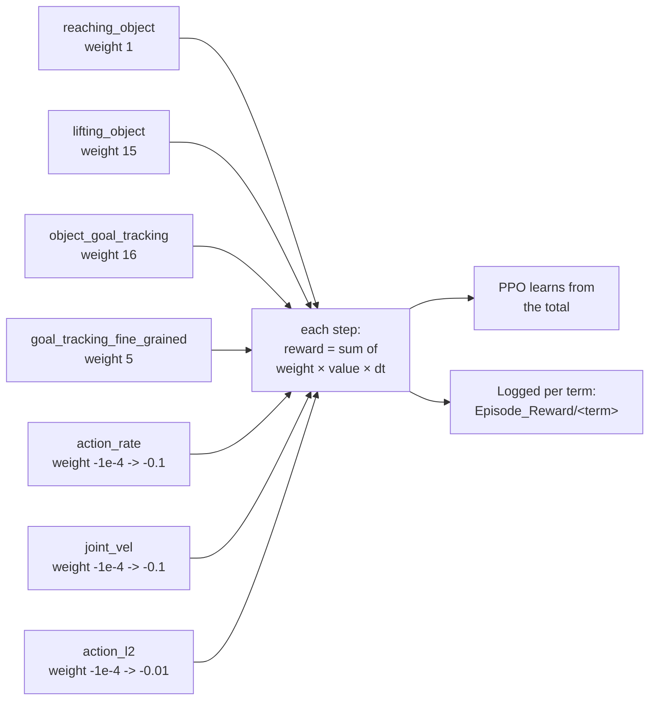
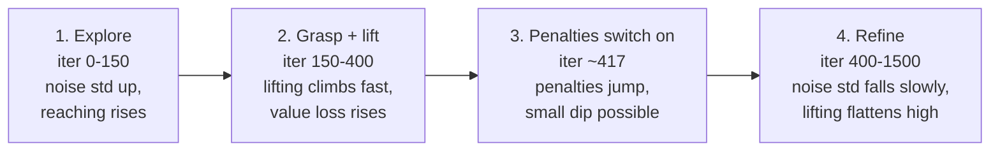
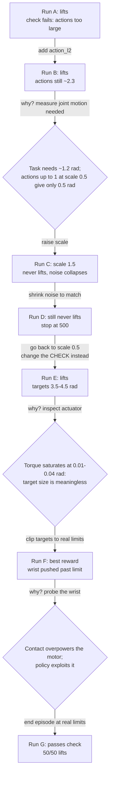
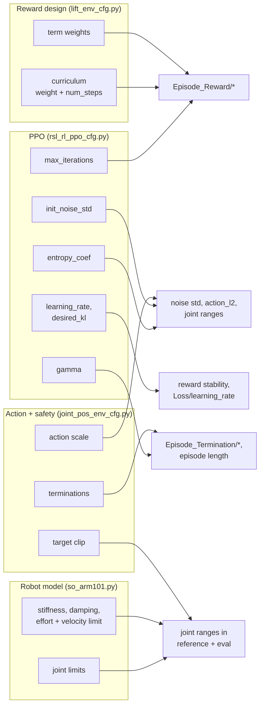
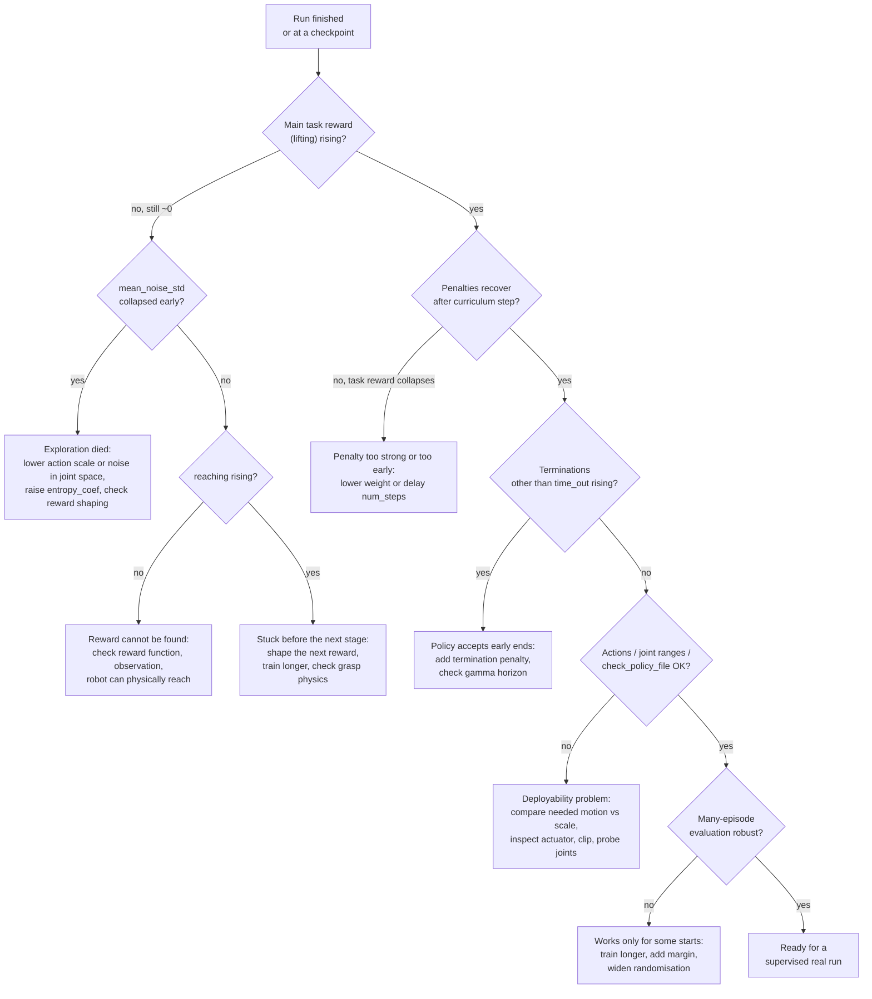
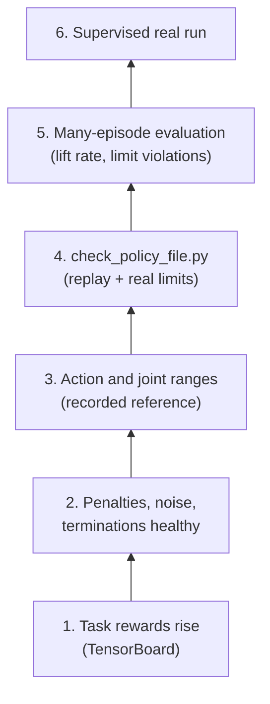

# Reading and tuning PPO training: a learner guide (SO-101 lift cube)

This guide teaches you how to **watch a reinforcement learning (RL) training run,
understand what the numbers mean, and decide what to change** when the result is
not good enough. It is built on a real series of seven training runs of the
SO-101 "lift the cube" task in Isaac Lab. Each run fixed one problem and, in
several cases, uncovered the next one.

By the end you should be able to:

1. Pick the rewards and other signals to monitor, and read what each one says.
2. Choose which parameter to change before retraining, and what to watch to see
   whether the change worked.
3. Read a set of curves and results and say **what is wrong**: the reward
   design, a hyperparameter, the robot model, or the safety limits.

> **Diagrams.** The flow diagrams are written in Mermaid. GitHub shows them
> directly. In VS Code, install the *Markdown Preview Mermaid Support*
> extension to see them in the Markdown preview. The charts are PNG images in
> the folder `rl_tuning_guide_img/`.

---

## The case study in one page

| Item | Value |
|---|---|
| Task | `Isaac-SO-ARM101-Lift-Cube-v0`: reach the cube, grasp it, lift it, carry it to a goal |
| Algorithm | PPO (rsl_rl), 4096 parallel arms, 24 steps per arm per iteration, 1500 iterations |
| Control | 50 Hz (`dt = 0.02 s`), one episode = 5 s = 250 steps |
| Action | 5 arm joint targets + 1 gripper open/close. Arm target = `default pose + 0.5 × action` |
| Goal | A policy that lifts in sim **and** passes `check_policy_file.py` so it can run on the real arm |
| Files you change | `tasks\lift\lift_env_cfg.py` (rewards, curriculum), `tasks\lift\joint_pos_env_cfg.py` (actions, terminations), `tasks\lift\agents\rsl_rl_ppo_cfg.py` (PPO settings) |

The whole workflow, and where each check happens:



The most important lesson of this series is in that diagram: **a high reward is
only the first gate.** Three of the seven runs had excellent rewards and still
could not go on the real arm.

---

## Part 1: Where the numbers come from

### 1.1 Every reward term is logged separately

The task's total reward is a sum of **reward terms**, each with a **weight**.
Isaac Lab logs every term on its own, and that is what makes diagnosis possible.



| Term | What it measures (value per step) | Weight | Best possible `Episode_Reward` |
|---|---|---|---|
| `reaching_object` | `1 - tanh(distance gripper-to-cube / 0.05)`: near 1 when touching | 1 | 1 |
| `lifting_object` | 1 if the cube is higher than 2.5 cm, else 0 | 15 | 15 |
| `object_goal_tracking` | if lifted: `1 - tanh(distance cube-to-goal / 0.3)` | 16 | 16 |
| `object_goal_tracking_fine_grained` | same, but `/ 0.05`: only scores when very close | 5 | 5 |
| `action_rate` | sum of (action − previous action)²: jerky actions | −0.1 (after curriculum) | 0 (best) |
| `joint_vel` | sum of joint speed²: fast motion | −0.1 (after curriculum) | 0 (best) |
| `action_l2` | sum of action²: large actions | −0.01 (after curriculum) | 0 (best) |

### 1.2 How to decode `Episode_Reward/<term>`

From the Isaac Lab source (`reward_manager.py`), each step adds
`weight × value × dt` to an episode sum, and the logged number is that sum
divided by the episode length in seconds (5 s). That simplifies to:

> **`Episode_Reward/<term>` = weight × (average value of the term over the episode)**

So you can turn every logged number back into something physical:

| Logged | Decode | Meaning |
|---|---|---|
| `lifting_object = 10.1` | 10.1 / 15 = 0.67 | The cube was in the air **67 % of the episode** |
| `reaching_object = 0.57` | 0.57 / 1 | On average the gripper is close to the cube |
| `object_goal_tracking = 0.92` | 0.92 / 16 = 0.06 | The lifted cube is usually **far from the goal** |
| `action_l2 = −0.32` at weight −0.01 | 0.32 / 0.01 = 32 = sum of 6 actions² | Each action is about √(32/6) ≈ **2.3** on average |
| `Train/mean_reward = 50` | ≈ 5 s × (sum of all `Episode_Reward` terms) | Total score of one episode |

Two cautions:

- An episode that **ends early** (a termination) is still divided by 5 s, so
  its rewards look smaller. When early terminations rise, rewards drop even
  if the behaviour did not get worse.
- Penalty terms are tiny until the **curriculum** raises their weights (1.4).
  A penalty that "suddenly gets 1000× worse" at iteration 417 is the
  curriculum, not a bug.

### 1.3 The other signals you must monitor

| Signal | What it is | Healthy | Warning sign |
|---|---|---|---|
| `Train/mean_reward` | Total episode score | Rises, then flattens high | Flat near 0, or falls and stays down |
| `Policy/mean_noise_std` | How random the actions still are (exploration) | Starts ~1, may rise a little early, falls slowly to ~0.4-0.6 | Falls to ~0.1 **before** the task is solved = exploration collapsed |
| `Loss/value_function` | How well the critic predicts returns | Rises as rewards appear, then settles | Tiny and flat all run = there is nothing to predict (no reward) |
| `Loss/surrogate` | PPO policy loss | Small, noisy around 0 | Not useful alone |
| `Loss/entropy` | Same information as noise std | Falls slowly | Plunges early (same as noise collapse) |
| `Train/mean_episode_length` | Steps before reset (max 250) | 250 if only time-outs end episodes | Drops = some termination fires often |
| `Episode_Termination/<term>` | Share of episodes that ended for that reason | `time_out` ≈ 1 | Any other term rising |
| `Metrics/object_pose/position_error` | Cube-to-goal distance (m) | Falls as goal tracking learns | Stays high = lifts but does not carry |
| `Curriculum/<term>` | Current penalty weight | Steps at iteration ~417 | — |

### 1.4 Iterations, steps and the curriculum

- One **iteration** = every arm takes 24 steps, then PPO updates once.
- The curriculum counts **steps per arm**: `num_steps = 10000` means
  10000 / 24 ≈ **iteration 417**. That is when `action_rate` and `joint_vel`
  jump from −0.0001 to −0.1 and `action_l2` jumps to −0.01.
- **On `--resume` the step counter restarts at 0**, so the curriculum
  restarts too: the penalties are weak again for the first ~417 iterations of
  the resumed run.

---

## Part 2: What a healthy run looks like

The figure shows every curve that matters for the final run (run G).


Read a run in **phases**:



What each panel tells you in run G:

- **lifting_object**: climbs from ~150 to ~600, then flattens at ~10 (cube
  in the air 67 % of the time). The task is learned.
- **object_goal_tracking**: only ~0.9 of 16. The policy lifts but rarely
  brings the cube to the goal. This is the next thing to improve.
- **reaching_object**: rises first. Reaching is learned before lifting.
- **penalties**: jump at iteration 417 (curriculum), then shrink as the
  policy smooths its motion. A penalty that recovers like this is healthy.
- **noise std**: rises early (the policy is exploring), then falls slowly. It
  never collapses.
- **value loss**: rises when real rewards appear, then settles. That is normal.
- **episode length** and **arm_joint_limits**: about 21 % of episodes end
  early on a joint limit. This is a warning sign, explained in Run G below.

---

## Part 3: The seven-run case study

Each run changed one thing. The table is the summary; the sections after it
show how each problem was found.

| Run | Change | Lifting (end) | Result | What it taught |
|---|---|---|---|---|
| **A** | Baseline task | 9.1 | Lifts, but fails the real-arm check: actions up to **7.8** | A good reward is not a deployable policy |
| **B** | + `action_l2` penalty | 10.0 | Lifts. Actions shrink only to ~2.3 RMS | A penalty cannot remove motion the task **needs** |
| **C** | Action scale 0.5 → **1.5** | **0** | Never lifts. Noise collapses to 0.08 | Scale multiplies exploration. Low loss ≠ learning |
| **D** | Scale 1.5 + noise std 0.33 | **0** (stopped at 500) | Never lifts. Noise collapses | Larger scale makes fine grasp control harder. Stop failing runs early |
| **E** | Back to scale 0.5, resume B for +1000 iter | 10.9 | Lifts. Targets **3.5-4.5 rad** past the joint | The **actuator model** made raw outputs meaningless |
| **F** | + clip targets to real joint limits | **11.7** (best) | Lifts best, but wrist forced to **−2.23 rad** (limit −1.66) | High reward can come from a **physics exploit** |
| **G** | + end episode at real joint limits | 10.1 | **Passes the check**. 50/50 lifts, 9/50 tiny overshoots | Termination works, but is a weak signal without a penalty |

The decisions in order:



Figure 2 puts all seven runs side by side. Each run keeps its own colour
throughout this guide.


*Runs A-F were deleted after the session. Their points are the TensorBoard
values sampled during the session (8 points per run for A, B, C, every 100
iterations for D, E, F). Run G is the full TensorBoard log.*

### Run A: a good reward that cannot be deployed

**Symptoms.** Training looked fine: lifting 9.1, mean reward 54.7. But
`check_policy_file.py` failed: *"Reference actions exceed the live safety
guard."* The guard allowed |action| ≤ 1.

**Diagnosis.** Look at the **actions themselves**, not only the reward. In
the recorded sim episode, the maximum |action| per joint was:

| shoulder_pan | shoulder_lift | elbow_flex | wrist_flex | wrist_roll | gripper |
|---|---|---|---|---|---|
| 3.14 | 4.50 | **7.81** | 5.74 | 2.29 | 6.62 |

All 250 steps were over the limit. Nothing in the task said "keep actions
small": `action_rate` only punishes **changes** in the action, not size.

**Lesson.** The reward only measures what you put in it. If the real robot
needs a property (small actions, joint limits, smooth motion), **something in
the training must ask for it**, and you must check it separately.

### Run B: a penalty cannot remove what the task needs

**Change.** Added `action_l2` (penalises action size), weight −0.0001 rising
to −0.01 at iteration 417.

**Symptoms.** Lifting still learned well (10.0 at iteration 770, faster than
run A). But `action_l2` flattened at about −0.32: actions about **2.3 RMS**,
still far above 1.

**Diagnosis.** Ask: *how big must the actions be to do the task at all?* A
target is `default + 0.5 × action`, so |action| ≤ 1 can move a joint only
±0.5 rad from the default pose. Measure how far the joints really moved in a
successful lift:


The arm must turn ~1.2 rad to reach the cube. **No policy can lift within
|action| ≤ 1 at scale 0.5**, so a stronger penalty would only trade lifting
away. (The wrist value of 3.9 is itself suspicious; Run F explains it.)

**Lesson.** When a penalty stops making progress, check whether the thing it
penalises is **physically required** by the task. Then change the task setup
(scale, default pose) or the limit, not the penalty weight.

### Run C: a bigger action scale, and a misleading "improvement"

**Change.** Arm action scale 0.5 → 1.5, so |action| ≤ 1 covers ±1.5 rad.

**Symptoms.** After 1500 iterations: mean reward **1.3** (run A: 54.7),
lifting **0**, but reaching 0.59. Someone reading only the loss would think
it improved:


**Diagnosis.**

- **Value loss 0.002 is not good news.** The critic predicts returns. If the
  policy earns almost nothing, the returns are easy to predict, so the loss
  is tiny. A low loss means "predictable", not "good".
- **`mean_noise_std` collapsed** from 1.0 to 0.08 by iteration ~850 (Figure 2).
  PPO explores by adding Gaussian noise to the action. In **joint space** the
  noise is `noise std × scale`: 1.0 × 1.5 = **±1.5 rad** of random motion.
  The arm flailed and knocked the cube away, so the policy learned the safe
  local optimum "hover near the cube" (reaching 0.59) and stopped exploring.
  With noise 0.08 it can never find a grasp.

**Lesson.** Judge a run by the **task rewards**, never by the loss. Changing
the action scale also changes the **effective exploration**.

### Run D: matching the noise, and when to stop a run

**Change.** Keep scale 1.5, set `init_noise_std = 0.33` so the joint-space
noise (0.33 × 1.5 ≈ 0.5 rad) equals runs A and B.

**Symptoms.** Lifting 0 at iterations 100, 200, 300, 400, 500, and noise
falling 0.33 → 0.16.

**Decision.** Stopped at 500. In the healthy runs lifting was clearly
non-zero by iteration ~300 (Figure 2). A run with **lifting still at 0 and
noise collapsing by 400-500** will not recover. Waiting for 1500 wastes
20 minutes.

**Lesson.** At scale 1.5, a small change in the network output moves the
joints 3× as far, so the fine control needed to close on a 3 cm cube is
harder to learn. Some fixes look right on paper and still fail. **Set an
early-stop rule before you start**, for example "lifting > 0.5 by
iteration 400".

### Run E: when the robot model makes raw outputs meaningless

**Change.** Back to the proven scale 0.5. Resumed run B from iteration 1000
for 1000 more iterations (because the curriculum restarts on resume, see
1.4). The safety check was changed to look at the **joint target**: the
target may be at most 1.5 rad from default.

**Symptoms.** Lifting ~10.9, but `action_l2` around −0.5 to −0.67 and the
check failed badly:

| | pan | lift | elbow | wrist_flex | wrist_roll |
|---|---|---|---|---|---|
| target sent, max offset (rad) | 3.52 | 4.31 | 1.76 | 1.83 | 4.55 |
| joint actually moved (rad) | 1.92 | 1.66 | 1.10 | 4.17 | 0.80 |

The policy asked for targets far **beyond** where the joints could go.

**Diagnosis.** Read the actuator settings in the robot config
(`robots\trs_so101\so_arm101.py`):


Torque = stiffness × (target − position), capped at 1.9 Nm. With stiffness
50-200, the motor is already at **full torque** once the target is only
0.01-0.04 rad away. So a target 4 rad away moves the arm **exactly the same**
as one 0.05 rad away. For this sim, the target size is only a **direction**.
The only thing keeping targets small was the weak `action_l2` penalty, so the
policy pushed them to extremes.

**Lesson.** Before you blame the reward or PPO, check the **robot model**
(stiffness, effort limit, velocity limit, joint limits). A safety rule on raw
policy outputs is meaningless when the actuator saturates. Limit what really
happens instead: the joint positions.

### Run F: the best reward, and a physics exploit

**Change.** Clip the joint targets inside the sim to the real arm's soft
limits (URDF limits minus 0.05 rad, the same values the real runner uses).
The check now tests what matters: **the joints in the sim reference must stay
inside the real soft limits**, because that is when the real runner aborts.

**Symptoms.** The best training so far: lifting **11.7**, the cube raised to
0.31 m. But the check failed:

| Joint | Reached in sim | Real soft limit | Over by |
|---|---|---|---|
| shoulder_pan | 1.89 | 1.87 | 0.02 |
| shoulder_lift | −1.70 | −1.695 | 0.005 |
| **wrist_flex** | **−2.23** | −1.61 | **0.62** |

The wrist target was clipped to +1.61, yet the wrist went to −2.23: past the
**sim's own** hard limit of −1.66.

**Diagnosis.** A small probe script commanded the wrist directly:


- In free space the wrist follows its target, so the motor and its direction
  are fine.
- During the policy's lift, the motor pushes toward +1.61 at full 1.9 Nm,
  but contact (the table, the cube or the arm's own links) pushes harder and
  forces the joint past its limit. The policy **learned to use this**.

On the real arm the wrist has a hard stop, so this lift could not happen.

**Lesson.** A reward that is "too good" deserves suspicion. When the reward
improves, check **how** the robot achieves it: joint ranges, contact, speeds.
Policies find every loophole in the simulator. This is called **reward
hacking** or a **sim exploit**.

### Run G: closing the loophole, and the horizon problem

**Change.** End the episode (a **termination**) whenever any arm joint leaves
the real soft limits, the same condition that aborts the real run. It is
turned off in the play configuration, so the recorded reference shows real
behaviour instead of hiding it with a reset.

**Symptoms.**


Lifting reached ~10, but the share of episodes ended by a joint-limit stop
**rose** to 21-25 % during training.

**Diagnosis: the discount horizon.** PPO uses `gamma = 0.98`. The policy
effectively looks ahead about **1 / (1 − gamma) = 50 steps = 1 second**.
Ending the episode only costs the reward of that next second, and the
termination itself carries no penalty. Breaking a limit to lift a bit better
can still pay off.

**Result.** Even so, the final policy played **without noise** behaved much
better than the noisy training episodes:

- `check_policy_file.py` **passes**. The reference stays inside the soft
  limits (closest 0.033 rad).
- On 50 episodes with random cube positions it **lifted all 50**. The wrist
  exploit is gone (worst excess 0.007 rad, previously 0.62).
- **9 of 50** still went slightly past a soft limit (shoulder_lift, at most
  0.034 rad). On the real arm about 1 attempt in 6 may stop safely near the
  top of the lift.
- `object_goal_tracking` fell to 0.9 (2.3 in runs A and B). The safer policy
  carries the cube to the goal less well. Constraints have a cost.

**Next steps you could try.** Add a penalty when the termination fires
(Isaac Lab `mdp.is_terminated_term`), and/or clip the targets ~0.05 rad
inside the termination bounds to leave room for overshoot.

---

## Part 4: Which parameter to change, and what to watch

### 4.1 The parameter map



### 4.2 Knob by knob

| Parameter (file) | What it controls | Too low / too small | Too high / too large | Watch after changing |
|---|---|---|---|---|
| Reward **weights** (`RewardsCfg`) | What the policy cares about | Behaviour ignored | Behaviour dominates; others suffer | That term's `Episode_Reward`, and whether the main task rewards drop |
| **Curriculum** weight and `num_steps` | When and how strongly penalties apply | Penalty never matters (run A actions) | Strong penalties early stop the policy exploring | Penalty curves around iteration `num_steps / 24` |
| **Action scale** (`JointPositionActionCfg.scale`) | Radians per unit of action; also exploration size | Cannot reach the needed poses (run B) | Coarse control, noisy exploration, may never learn (runs C, D) | `lifting_object`, `mean_noise_std` |
| **Target clip** (`clip=`) | Hard bound on joint targets | — | — | Joint ranges in the reference and evaluation |
| **Terminations** (`TerminationsCfg`) | When an episode ends early | — | Too strict: short episodes, slow learning | `Episode_Termination/*`, `mean_episode_length` |
| **`init_noise_std`** | Starting exploration | Never discovers the task | Flailing, knocks things over | `mean_noise_std` early, first non-zero task reward |
| **`entropy_coef`** | Pressure to keep exploring | Early collapse of noise | Never settles; reward noisy | `mean_noise_std`, `Loss/entropy` |
| **`gamma`** | How far ahead the policy plans (≈ 1/(1−γ) steps) | Short-sighted: early ends look cheap (run G) | Slower, noisier learning | Terminations, long-term rewards |
| **`learning_rate`, `desired_kl`** | Size of each policy update | Very slow progress | Reward spikes and crashes | `Loss/learning_rate`, stability of `mean_reward` |
| **`max_iterations`** | Training length | Stops before flattening | Wasted time | Whether the task rewards have flattened |
| **Actuator** stiffness / effort (robot config) | How the sim arm responds to targets | Arm sags, cannot lift | Saturates instantly; targets become "directions" (run E) | Target vs. joint position in a probe |

### 4.3 Rules for retraining

1. **Change one thing per run.** If you change two, you cannot tell which one
   helped.
2. **Write down the expected effect first.** For example: "action_l2 at −0.01
   should bring `action_l2` above −0.06 after iteration 420 while
   `lifting_object` stays above 8."
3. **Set a stop rule.** For this task: lifting > 0.5 by iteration ~400, and
   noise std not below ~0.3 before lifting appears. If not, stop.
4. **Compare with a baseline run** at the **same iteration**, not at the end.
5. **Balance weights in the decoded units of 1.2.** A full lift is worth up to
   15 per second; `action_l2` at −0.01 with actions of RMS 2.3 costs 0.32 per
   second. That is why the penalty lost against lifting in run B.
6. **On resume, remember the curriculum restarts.** Give at least
   `num_steps / 24` iterations plus a few hundred more.
7. **Scale and noise are linked.** Joint-space noise = `noise std × scale`.
8. **After any change to actions or limits, rerun the full check chain**
   (export, record, `check_policy_file.py`, multi-episode evaluation).

---

## Part 5: Diagnosing a run

### 5.1 Decision tree



### 5.2 Symptom table

| What you see | Most likely cause | Seen in | What to do |
|---|---|---|---|
| Task reward ~0, loss tiny, noise std → 0.1 | Exploration collapsed into a local optimum | C, D | Reduce effective joint noise, raise `entropy_coef`, revert the change |
| Reaching good, lifting 0 | Grasp not discovered | C, D | Check exploration, gripper action, cube physics |
| Lifting good, goal tracking low, position error high | Lifts but does not carry | G | Raise goal-tracking weight or train longer |
| Penalty jumps at iteration ~417 | Curriculum (normal) | all | Check it recovers within ~200 iterations |
| Penalty plateaus while task reward is high | The penalised behaviour is needed by the task | B | Measure what the task needs; change scale or pose, not the weight |
| Reward high, check fails on action size | Nothing in the reward limits action size | A | Add a penalty or a hard limit; check the robot model |
| Targets far beyond the joint motion | Actuator saturates; targets are directions | E | Limit joint positions (clip, terminations), not raw outputs |
| Joint beyond its own limit in sim | Contact exploit | F | Probe the joint; add a termination at the real limits |
| Termination share rises while reward rises | Ending early is cheap (horizon ≈ 1/(1−γ)) | G | Penalise the termination; leave a margin |
| Very good reward, suspicious behaviour | Reward hacking | F | Look at joint ranges, contacts and videos, not only the reward |

---

## Part 6: Beyond the reward, the verification ladder

Every rung catches problems the rung below cannot:



| Run | 1. Rewards | 2. Training signals | 3-4. Ranges + check | 5. 50-episode eval |
|---|---|---|---|---|
| A | pass | pass | **fail** (actions 7.8) | — |
| B | pass | penalty plateau | fail (actions ~2.3) | — |
| C | **fail** | noise collapse | — | — |
| D | **fail** | noise collapse | — | — |
| E | pass | pass | **fail** (targets 3.5-4.5 rad) | — |
| F | pass (best) | pass | **fail** (wrist −2.23) | — |
| G | pass | terminations 21 % | **pass** | 50/50 lift, 9/50 small overshoot |

---

## Tools and commands

Set up PowerShell as in the other guides:

```powershell
cd C:\isaacsimlab\isaac_so_arm101
$py = "C:\isaacsimlab\env_isaaclab\Scripts\python.exe"
```

| Purpose | Command |
|---|---|
| Train | `& $py -m isaac_so_arm101.scripts.rsl_rl.train --task Isaac-SO-ARM101-Lift-Cube-v0 --headless` |
| Resume a run (curriculum restarts!) | add `--resume --load_run <run folder> --checkpoint model_1000.pt --max_iterations 1000` |
| TensorBoard | `& $py -m tensorboard.main --logdir logs\rsl_rl\lift` then open `http://localhost:6006` |
| Text summary of a run | `& $py C:\SO101wClaudeIsaac\tools\tb_summary.py logs\rsl_rl\lift\<run> --points 8` |
| Export `policy.pt` | `& $py -m isaac_so_arm101.scripts.rsl_rl.play --task Isaac-SO-ARM101-Lift-Cube-Play-v0 --num_envs 16 --checkpoint <run>\model_1499.pt` |
| Record the reference | `& $py <lab_rl>\record_sim_reference.py --policy <full path>\exported\policy.pt --headless` (use the **full** path) |
| Check (lerobot env) | `python check_policy_file.py` in `lab_rl` |

In the console output, find these lines each iteration:

```text
Learning iteration 678/1500
    Mean action noise std: 0.63               <- exploration
          Mean reward: 49.68                  <- total score
    Episode_Reward/lifting_object: 10.05      <- main task (max 15)
    Episode_Reward/action_l2: -0.32           <- decode: 0.32 / 0.01 = 32
    Episode_Termination/arm_joint_limits: 0.2 <- share of early ends
```

---

## Exercises

1. **Decode.** A run logs `lifting_object = 6.0` and `action_rate = −0.8`
   with the curriculum weight −0.1. What fraction of the episode is the cube
   lifted? What is the average sum of squared action changes per step?
2. **Diagnose.** A run shows `reaching_object` 0.7, `lifting_object` 0,
   `mean_noise_std` 0.12 at iteration 600, and `Loss/value_function` 0.001.
   Which run in this guide does it resemble? Name two changes you would try.
3. **Predict.** You double `init_noise_std` and halve the action scale. What
   happens to the joint-space exploration? What do you expect to see in
   `mean_noise_std` and `lifting_object`?
4. **Horizon.** With `gamma = 0.98` and `dt = 0.02 s`, how many seconds ahead
   does the policy effectively plan? What changes at `gamma = 0.99`? Why might
   that help run G?
5. **Design.** Write the reward term (name, function, weight) you would add to
   run G to penalise the joint-limit termination. Estimate a weight so that
   one violation costs about 20 points of episode reward. (Hint: one step adds
   `weight × value × dt`.)
6. **Verify.** Your new run has the best `lifting_object` ever. List the
   checks you would run before saying it is better, and say which run in this
   guide shows why.

<details>
<summary>Answers</summary>

1. 6.0 / 15 = **40 %** of the episode. 0.8 / 0.1 = **8** per step on average.
2. Runs **C/D**: exploration collapsed into "hover near the cube". Try a
   smaller action scale or noise in joint space, a higher `entropy_coef`, or
   undo the last change. Also check that a grasp is physically possible.
3. Joint-space noise = 2 × 0.5 = unchanged (`noise std × scale`). But the
   reachable range per unit of action is halved, so the policy needs larger
   actions; watch `action_l2` and whether lifting still appears.
4. 1 / (1 − 0.98) = 50 steps = **1 s**. At 0.99: 100 steps = **2 s**. The
   policy then values more of the reward it loses by ending early, so
   breaking a limit costs more.
5. Example: `limit_penalty = RewTerm(func=mdp.is_terminated_term, weight=-1000.0, params={"term_keys": "arm_joint_limits"})`.
   One step: −1000 × 1 × 0.02 = **−20**. The play configuration switches the
   termination off, so set this reward term to `None` there too, or the
   penalty would look for a termination that does not exist.
6. Joint and action ranges in a recorded episode, `check_policy_file.py`, a
   many-episode evaluation, and a look at **how** it lifts (probe or video).
   Run **F** had the best reward and a wrist exploit.

</details>
