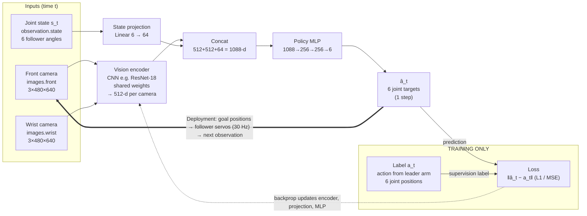
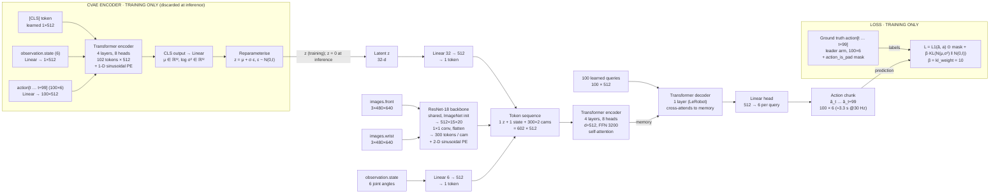

# Imitation Learning on the SO-101 Robot Arm

> Diagram image files `diagram1_bc.png` and `diagram2_act.png` (plus editable `.svg` versions) must sit in the same folder as this file.

Behaviour Cloning and ACT (Action Chunking with Transformers): concepts, data, architectures, and tensor-level inputs and outputs.

All shapes below assume:

- An **SO-101 follower arm** with 6 joints.
- **Two 640×480 cameras** recording at 30 fps.
- **LeRobot's default ACT settings**.

---

## 1. What imitation learning is

### Definition

In **imitation learning (IL)**, a robot learns a control policy from **expert demonstrations** instead of from a hand-written controller or a reward signal.

On the SO-101, the expert is a person moving the **leader arm** by hand while the **follower arm** copies it. Each demonstration is a time series of what the robot saw and what the human told it to do.

### Formulation: behaviour cloning

The most common form of IL is **behaviour cloning (BC)**, which turns control into supervised learning.

- **Dataset:** $\mathcal{D} = \{(o_t, a_t)\}$
  - $o_t$ is the observation: camera images plus joint state.
  - $a_t$ is the expert action at time $t$.
- **Policy:** we learn $\pi_\theta(a \mid o)$ by minimising a regression loss:

  $$\mathcal{L} = \mathbb{E}_{(o,a)\sim\mathcal{D}}\,\lVert \pi_\theta(o) - a \rVert_1$$

- **Deployment:** the policy reads the current observation and outputs the next joint targets. This runs in a closed loop at the control rate, which is 30 Hz on the SO-101.

### Imitation learning vs reinforcement learning

| | Imitation learning | Reinforcement learning |
|---|---|---|
| Learning signal | Expert actions (labels) | Reward function |
| Data source | Human teleoperation | Robot trial and error |
| Sample efficiency | High (~50 demos can be enough for one task) | Low (often needs simulation) |
| Ceiling | Bounded by demo quality | Can exceed the human |

### Two classic problems in behaviour cloning

1. **Compounding error (covariate shift).**
   - Small prediction errors push the robot into states that never appeared in the demos.
   - Predictions get worse in those states, and errors snowball over a long horizon $T$, roughly as $O(T^2)$.
   - DAgger fixes this by collecting more expert labels on the robot's own states.
   - ACT addresses it with **action chunking** instead.
2. **Multimodality.**
   - Humans demonstrate the same task in different ways, for example going left or right around an obstacle, or pausing at different points.
   - A plain L2 regressor averages these modes and produces an invalid in-between motion.
   - ACT handles this with a **CVAE latent variable**.

---

## 2. Training data and model outputs for the SO-101

### 2.1 Hardware that generates the data

- **Follower arm:** 6 Feetech STS3215 servos, controlling `shoulder_pan`, `shoulder_lift`, `elbow_flex`, `wrist_flex`, `wrist_roll` and `gripper`.
- **Leader arm:** same kinematics as the follower. A person moves it by hand, and its joint encoder readings become the **action**.
- **Cameras:** typically 1–2 USB cameras, for example a fixed front/top view and a wrist camera, each at 640×480 and 30 fps.

### 2.2 What is recorded at each time step (30 Hz)

`lerobot-record` stores every frame as a row with these fields:

| Key | Shape | Meaning |
|---|---|---|
| `observation.state` | (6,) float32 | Follower's **measured** joint positions (proprioception) |
| `observation.images.front` | (3, 480, 640) | Front camera RGB frame |
| `observation.images.wrist` | (3, 480, 640) | Wrist camera RGB frame (optional) |
| `action` | (6,) float32 | Leader's joint positions, i.e. the **target** the follower should move to |
| `timestamp`, `frame_index`, `episode_index`, `index`, `task_index` | scalars | Bookkeeping |

> **Key point for learners:** `action` at time *t* is where the **leader** is, while `observation.state` is where the **follower** actually is. The model learns to map *what I see + where I am* to *where the human wanted me to go*.

### 2.3 Dataset structure (LeRobotDataset format)

```
my_dataset/
├── data/      *.parquet        # tabular: state, action, indices, timestamps
├── videos/    *.mp4            # camera streams, encoded per camera
└── meta/
    ├── info.json               # fps, feature names/shapes, robot type
    ├── stats.json              # mean/std/min/max per feature (used for normalisation)
    ├── episodes …              # episode boundaries and lengths
    └── tasks …                 # natural-language task string
```

Exact file names inside `meta/` vary between LeRobot dataset versions. The split into parquet files, MP4 videos and metadata stays the same.

### 2.4 Practical data requirements

- **Quantity:** about 50 episodes is the usual starting point for one task. Each episode lasts about 10–30 s, which is roughly 300–900 frames.
- **Variation:** vary object positions and cover the workspace evenly. If the cube is always in the same spot, the policy only works in that spot.
- **Consistency:** keep the camera mounts, lighting and task string the same for every episode. Moving a camera after recording effectively invalidates the dataset.
- **Quality:** demos should be smooth and successful. Discard failed episodes, because BC copies mistakes faithfully.

### 2.5 Model output

- **Training output:** a checkpoint folder `pretrained_model/` containing `config.json`, `model.safetensors` and `train_config.json`, plus the normalisation statistics.
- **Inference output:**
  - **BC:** one 6-value joint target per step.
  - **ACT:** a `(100, 6)` chunk of future joint targets.
  - In both cases the outputs are de-normalised and sent to the follower servos as goal positions.

---

## 3. Architecture diagram: Behaviour Cloning

Plain BC is supervised regression. Each 30 Hz frame is one training sample:

- **Input:** the robot's observation at that instant.
- **Label:** the leader arm's joint positions at the same instant.

### Diagram 1: Behaviour Cloning (rendered)


*Legend: grey = recorded data / input, green = learned module, orange (dashed zone) = training-only path, blue = policy output and deployment loop.*

### Diagram 1: Behaviour Cloning (Mermaid version)



### BC: inputs and outputs

| Role | Tensor | Shape (per sample) | Source / meaning |
|---|---|---|---|
| Input | `observation.images.front` | `3×480×640` | Front camera frame at time t, scaled to [0,1] and normalised |
| Input | `observation.images.wrist` | `3×480×640` | Wrist camera frame at time t (optional second view) |
| Input | `observation.state` | `6` | Follower's measured joint angles (pan, lift, elbow, wrist flex, wrist roll, gripper) |
| Label | `action` | `6` | Leader arm joint positions at time t, i.e. what the human commanded |
| Output | `â_t` | `6` | Predicted joint targets for the next control tick, de-normalised and sent to the servos |

**Limitation:** the policy commits to a single step every 1/30 s. Small errors push the arm into states the demonstrations never covered, and those errors compound. ACT is designed to reduce this.

---

## 4. ACT: Action Chunking with Transformers

### 4.1 What ACT is

**ACT** was introduced by Zhao et al. (2023) with the ALOHA bimanual system.

- It is a **behaviour-cloning policy architecture**, so it is one specific way to implement imitation learning.
- It is the default starter policy in LeRobot for the SO-100/SO-101 arms.
- It trains in a few hours on one GPU and works well from about 50 demos.

### 4.2 The three ideas in ACT

| ACT idea | Mechanism | IL problem addressed |
|---|---|---|
| **Action chunking** | Predict the next *k* actions (k = 100, about 3.3 s at 30 Hz) from one observation | Cuts the effective decision horizon by a factor of *k*, which reduces compounding error. Also absorbs pauses and other non-Markovian human behaviour. |
| **CVAE latent style variable *z*** | During training, an encoder compresses the demo's action sequence into *z*. At inference, *z* = 0 (the prior mean). | Multimodality and human variation: the decoder does not have to average conflicting demos. |
| **Temporal ensembling** (optional) | Query every step and blend overlapping chunks with weights $w_i = e^{-m\,i}$, where m = 0.01 | Smooths the jerks that happen at chunk boundaries |

### 4.3 Architecture diagram: ACT

### Diagram 2: ACT (rendered)


*Legend: grey = recorded data / input, green = learned module, orange (dashed zones) = CVAE encoder and loss, used only during training; blue = action chunk output.*

### Diagram 2: ACT (Mermaid version)



### 4.4 Data flow in text form

```
TRAINING ONLY – CVAE encoder (4-layer transformer encoder)
  [CLS] + proj(observation.state) + proj(action[t : t+100])   →  μ, log σ²  →  z ∈ ℝ^32
                                                                        (inference: z = 0)

POLICY (encoder–decoder transformer, d_model = 512, 8 heads)
  Camera image (3×480×640) → ResNet-18 (ImageNet) → 512×15×20 feature map
                           → 300 tokens + 2-D sinusoidal positional encoding  (per camera)
  observation.state (6)    → linear → 1 token
  z (32)                   → linear → 1 token
        ↓
  Transformer encoder (4 layers) over [z, state, 300 × n_cameras image tokens]
        ↓
  Transformer decoder (1 layer in LeRobot): 100 learned queries cross-attend to encoder output
        ↓
  Linear head → actions  (100 × 6)
```

The 300 tokens per camera come from the ResNet-18 stride of 32: 480/32 × 640/32 = 15 × 20 = 300.

### 4.5 ACT: inputs and outputs

| Role | Tensor | Shape (per sample) | Source / meaning |
|---|---|---|---|
| Input | `observation.images.front` | `3×480×640` | Front camera at time t → 15×20 feature grid → 300 visual tokens |
| Input | `observation.images.wrist` | `3×480×640` | Wrist camera at time t → 300 more tokens (same backbone) |
| Input | `observation.state` | `6` | Follower joint angles → 1 proprioceptive token |
| Input | `z` | `32` | Style latent from the CVAE encoder during training; all zeros at inference |
| Label | `action[t:t+100]` | `100×6` | Leader positions for the next 100 frames, via `delta_timestamps = [i/30 for i in range(100)]` |
| Label | `action_is_pad` | `100` (bool) | True where the window runs past the end of the episode; those steps are excluded from L1 |
| Output | `â[t:t+100]` | `100×6` | Predicted joint targets for the next 100 control ticks |

### 4.6 Loss

$$\mathcal{L} = \underbrace{\lVert \hat a_{t:t+k} - a_{t:t+k} \rVert_1}_{\text{reconstruction (L1)}} + \beta\,\underbrace{D_{KL}\big(q(z\mid a, s)\,\|\,\mathcal{N}(0,I)\big)}_{\text{regularise latent}}, \quad \beta = 10$$

- **Why L1 and not L2:** L1 gives sharper, more precise actions.
- **Episode ends:** near the end of an episode there are fewer than 100 future actions. The missing steps are padded and masked out of the loss with `action_is_pad`.

### 4.7 Key LeRobot ACT defaults

| Parameter | Default |
|---|---|
| `chunk_size` | 100 |
| `n_action_steps` | 100 |
| `dim_model` | 512 |
| `n_heads` | 8 |
| `dim_feedforward` | 3200 |
| `n_encoder_layers` | 4 |
| `n_decoder_layers` | 1 |
| `latent_dim` | 32 |
| `n_vae_encoder_layers` | 4 |
| `use_vae` | True |
| `kl_weight` | 10 |
| `vision_backbone` | resnet18 (ImageNet weights) |
| `optimizer_lr` | 1e-5 |
| `optimizer_weight_decay` | 1e-4 |
| `batch_size` | 8 |
| Training steps | 100k (50–100k often enough for 50 demos) |

### 4.8 Executing the chunk at inference

1. **Query:** at t = 0, the policy reads two camera frames and 6 joint angles (with z = 0) and outputs a 100 × 6 chunk.
2. **Execute:** with `n_action_steps = 100`, the robot executes all 100 targets open-loop over about 3.3 s, then queries again.
3. **Trade-off:**
   - Large chunks give smooth motion but react slowly if the object moves.
   - Lowering `n_action_steps` to about 20–50 makes the policy more reactive.
   - Enabling `temporal_ensemble_coeff = 0.01` queries every step and averages the overlapping predictions for the current step with weights $w_i = e^{-0.01\,i}$. This is smoother and more reactive, but costs more compute.

### 4.9 How ACT relates to imitation learning

| Concept | Relationship |
|---|---|
| Imitation learning | The paradigm: learn a policy from human demonstrations |
| Behaviour cloning | The method: supervised regression from observation to expert action |
| ACT | An architecture that implements BC, adding action chunking, a transformer and a CVAE latent |

| | BC (plain) | ACT |
|---|---|---|
| Network | CNN + MLP | ResNet-18 + transformer encoder–decoder + CVAE |
| Input | Images + state | Images + state + z |
| Output per query | 1 × 6 | 100 × 6 |
| Handles compounding error | No | Yes (chunking) |
| Handles multimodal demos | No (averages modes) | Yes (CVAE latent z) |
| Loss | L1 / MSE | Masked L1 + 10·KL |

---

## 5. End-to-end LeRobot pipeline

Command flags change between LeRobot releases, so check `--help` on the installed version.

```bash
# 1. Record demonstrations (leader–follower teleoperation)
lerobot-record --robot.type=so101_follower --robot.port=/dev/ttyACM0 \
  --robot.cameras="{front: {type: opencv, index_or_path: 0, width: 640, height: 480, fps: 30}}" \
  --teleop.type=so101_leader --teleop.port=/dev/ttyACM1 \
  --dataset.repo_id=<user>/so101_pick_cube --dataset.num_episodes=50 \
  --dataset.single_task="Pick the cube and place it in the bowl"

# 2. Train ACT
lerobot-train --dataset.repo_id=<user>/so101_pick_cube --policy.type=act \
  --output_dir=outputs/train/act_so101 --policy.device=cuda

# 3. Evaluate: run lerobot-record with --policy.path pointing at the trained checkpoint
```

---

## 6. Summary

- **Imitation learning** is the paradigm: learn from human demonstrations.
- **Training data** on the SO-101 is synchronised camera images, the follower's joint state, and the leader's joint positions as actions.
- **ACT** is a behaviour-cloning architecture that reads images and joint state and outputs 100-step chunks of 6-D joint targets.
- Its **action chunking** addresses imitation learning's compounding-error problem, and its **CVAE latent** addresses the multimodality problem.

---

## Intentional omissions

- SO-101 motor calibration and motor-ID setup
- Comparisons with Diffusion Policy, SmolVLA and π0
- DAgger implementation details
- Dropout and layer-norm details, and image normalisation statistics
- The original ALOHA 14-DoF bimanual configuration
- Note: the BC network sizes in Section 3 (Linear 6→64, MLP 1088→256→256→6) are a representative baseline, not a fixed LeRobot preset.
